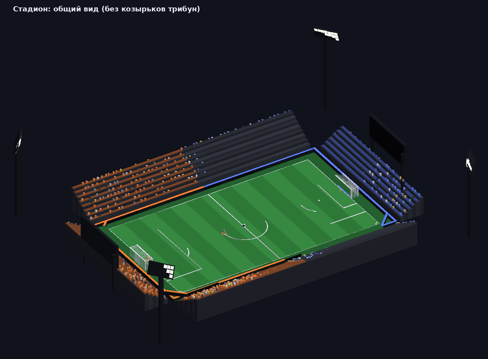
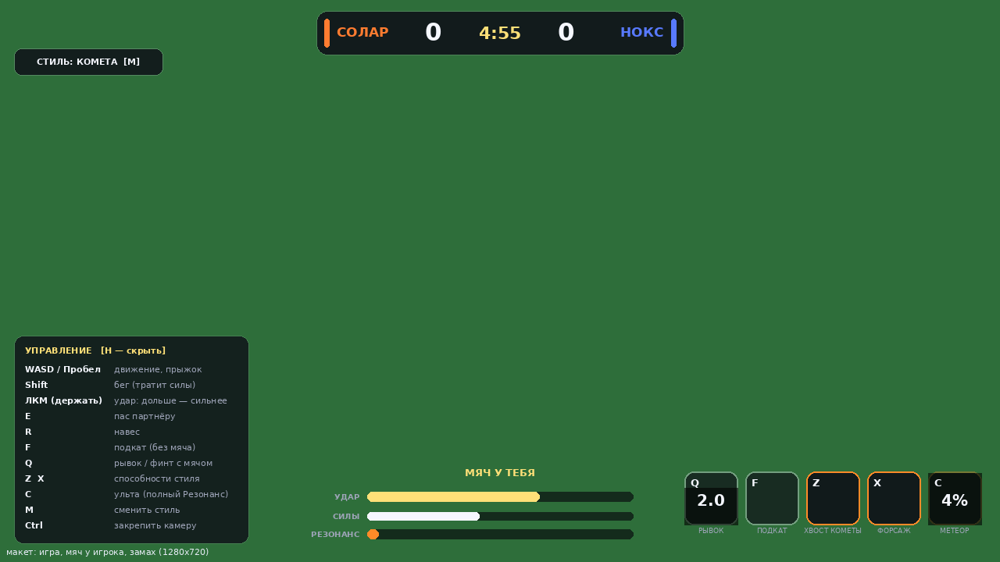
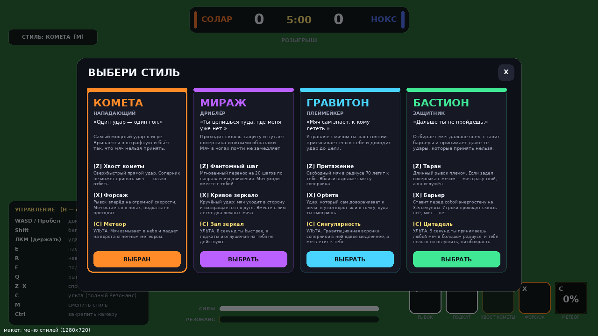
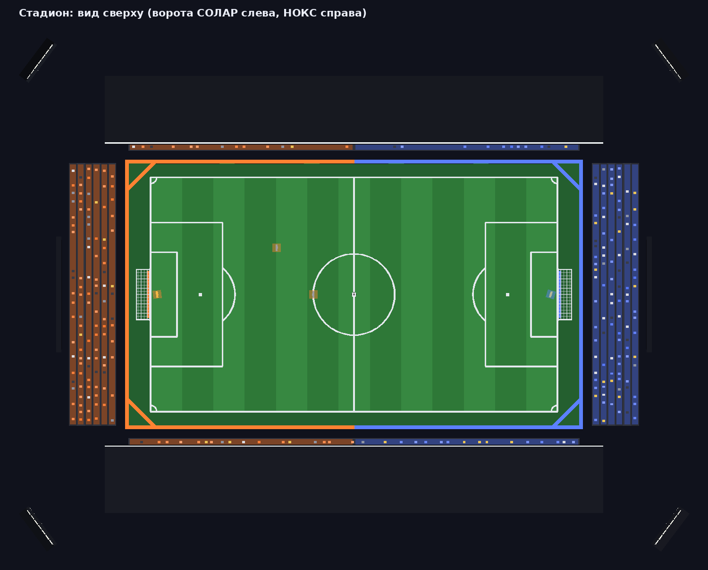
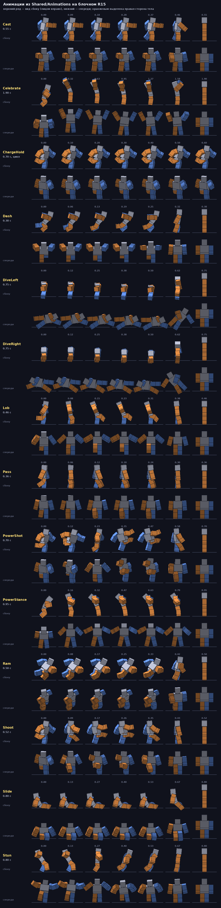

# RESONANCE — аниме-футбол со стилями для Roblox

Своя игра в жанре аниме-футбола: две команды, мяч, вратари-боты и **стили** — наборы способностей с ультой.
Название, стили, поле и анимации здесь оригинальные (рабочее название меняется одной строкой в `Config.GameTitle`).

Всё сделано кодом: стадион строится скриптом при запуске, анимации заданы позами в Luau, эффекты собраны из
деталей и частиц. Внешних моделей, текстур и анимаций игра не использует.



> Картинки в этом файле — не скриншоты Roblox. Это упрощённая отрисовка тех же данных, которые создаёт код
> (детали стадиона, позы анимаций, дерево интерфейса). В Studio всё будет с материалами, светом и неоном.

## Как запустить

1. Скачай файл [`build/Resonance.rbxlx`](build/Resonance.rbxlx).
2. Открой его в **Roblox Studio** (двойной клик или *File → Open from File*).
3. Нажми **Play (F5)**. Появится меню стилей, затем отсчёт и розыгрыш с центра.
4. Проверить игру вдвоём на одном компьютере: вкладка *Test → Clients and Servers → Start* (2 игрока).
5. Выложить в Roblox: *File → Publish to Roblox*.

Одному играть можно: в воротах обеих команд стоят боты-вратари.

Игра рассчитана на аватары **R15** (в новых местах это стандарт). На R6 всё работает, но без моих анимаций.

### Если хочешь добавить игру в своё уже существующее место

Открой `Resonance.rbxlx`, скопируй три папки и вставь в те же сервисы у себя:
`ReplicatedStorage/Shared`, `ServerScriptService/Server`, `StarterPlayer/StarterPlayerScripts/Client`.
Стадион строится в начале координат — убери оттуда Baseplate и SpawnLocation.

## Управление

| Клавиша | Действие |
|---|---|
| WASD, Пробел | движение, прыжок |
| Shift | бег (тратит силы) |
| ЛКМ (держать и отпустить) | удар: чем дольше держишь, тем сильнее. Смотришь камерой выше — мяч летит выше |
| E | пас. Сам находит партнёра в направлении взгляда |
| R | навес |
| F | подкат (только без мяча): выбивает мяч и оглушает соперника |
| Q | рывок. С мячом это финт: в этот момент подкат по тебе не проходит |
| Z, X | способности стиля |
| C | ульта — когда полоска Резонанса заполнена |
| M | меню стилей |
| H | показать/скрыть подсказку |
| Ctrl | закрепить камеру (Shift Lock перенесён сюда, потому что Shift — это бег) |

Геймпад и сенсорные кнопки для телефона привязаны, но вживую не проверялись.
Клавиши меняются в `src/shared/Config.luau`, раздел `Controls`.



## Правила игры

- Мяч подбирается сам, когда подбегаешь к нему. С мячом ты чуть медленнее.
- Слабый мяч можно принять. Слишком быстрый — только **отбить**: он отлетает от игрока. Партнёр принимает более сильные передачи, чем соперник.
- Аутов нет: поле окружено бортами, мяч от них отскакивает. За воротами тоже можно играть.
- **Резонанс** копится сам и за удачные действия: гол, голевой пас, отбор, финт, блок, точный пас. Полная полоска = можно включить ульту.
- Матч идёт 5 минут. После гола — розыгрыш с центра у пропустившей команды. После финального свистка сразу начинается новый матч.

## Стили

| Стиль | Роль | Z | X | Ульта (C) |
|---|---|---|---|---|
| **Комета** | нападающий | *Хвост кометы* — сверхбыстрый удар, который нельзя принять | *Форсаж* — длинный рывок с мячом | *Метеор* — мяч взмывает вверх и падает на ворота |
| **Мираж** | дриблёр | *Фантомный шаг* — перенос на 20 шагов | *Кривое зеркало* — кручёный удар с ложными мячами | *Зал зеркал* — 8 с скорости и неуязвимости к отбору |
| **Гравитон** | плеймейкер | *Притяжение* — мяч летит к тебе | *Орбита* — удар сам доворачивает в цель | *Сингулярность* — воронка замедляет соперников и тянет мяч |
| **Бастион** | защитник | *Таран* — рывок, отбирающий мяч | *Барьер* — стена, которую не проходит мяч | *Цитадель* — 9 с принимаешь любой удар в большом радиусе |



## Как добавить свой стиль (своего OC)

1. Скопируй `src/shared/Styles/_Template.luau` и назови файл именем стиля без подчёркивания, например `Phoenix.luau`.
2. Поменяй `id`, `name`, `role`, цвета, характеристики (`stats`) и способности.
3. Пересобери место (см. ниже) — стиль сам появится в меню.

В шаблоне расписано, что доступно способности: удар по мячу с любыми параметрами, рывки и телепорт,
притяжение мяча, бафы скорости, неуязвимость, «окно отбора», а на клиенте — сферы, диски, лучи, шлейфы,
послеобразы, тряска камеры, анимации. Готовые четыре стиля в той же папке — хорошие примеры.

Новая анимация — это новая запись в `src/shared/Animations.luau`: несколько ключевых поз (углы суставов R15).

## Что где лежит

```
src/shared/     общий код: Config (весь баланс), FieldSpec (размеры поля), Animations, Styles
src/server/     FieldBuilder (стадион), BallService (мяч), MatchService (матч), ActionService (действия игроков),
                Actors (состояние игроков), BotService (вратари), PlayerService, Physics, Net
src/client/     Controls (управление), Hud (интерфейс), Fx и FxEvents (эффекты), ProcAnimator (анимации),
                BallVisuals (шлейф и вращение мяча), Sfx (звук)
build/          Resonance.rbxlx — готовое место для Studio
tools/          проверка без Studio: эмулятор, дымовой тест, отрисовка картинок
docs/           картинки для этого файла
```

Числа баланса (скорости, сила удара, перезарядки, длина матча, цвета и названия команд) собраны в
`src/shared/Config.luau`. Свет и вид стадиона — в `src/server/FieldBuilder.luau`.



## Анимации

Все анимации заданы кодом и проигрываются поверх стандартного бега Roblox: замах, удар, усиленный удар,
пас, навес, подкат, рывок, таран, оглушение, «каст», стойка ульты, празднование гола, прыжки вратаря.



## Что проверено, а что нет

Roblox Studio из среды, где писался код, запустить нельзя. Поэтому я сделал эмулятор (`tools/harness`):
он загружает собранный `.rbxlx`, выполняет настоящий серверный и клиентский код и проигрывает матч.
Имена и типы свойств Roblox при этом проверяются по настоящей базе API.

**Проверено эмулятором (116 проверок, 0 ошибок выполнения):** постройка стадиона, вход игрока и команды,
интерфейс, розыгрыш, подбор и ведение мяча, спринт и силы, удар с зарядом, пас, навес, рывок, подкат, финт,
блок быстрого удара, все 12 способностей с их эффектами, гол и счёт, вратари (ловят, прыгают, выбивают),
респаун, выход игрока, финальный свисток и новый матч.

Отдельно идёт стресс-тест (`tools/harness/monkey.luau`): три игрока несколько минут жмут случайные кнопки,
шлют серверу мусор, перерождаются и выходят из игры прямо с мячом. Восемь прогонов по 150 секунд — без ошибок.

**Не проверено — это покажет только запуск в Studio:**

- настоящая физика Roblox: отскоки мяча, передача сетевого владения мячом, ощущение рывков;
- как всё выглядит: свет, материалы, эффекты, анимации на настоящих аватарах;
- задержка сети между игроками;
- сенсорные кнопки и геймпад;
- звуки: сейчас это встроенные звуки Roblox как заглушки (заменяются в `Config.Sounds`).

Если в Studio что-то сломается или выглядит не так — пришли текст ошибки из окна *Output* или опиши, что
происходит, и это быстро чинится.

## Для разработки

Нужны [Rojo](https://rojo.space), [Lune](https://lune-org.github.io/docs), Selene и StyLua.

```sh
rojo build default.project.json -o build/Resonance.rbxlx   # собрать место
./tools/check.sh                                            # формат, линтер, сборка, дымовой тест
./tools/check.sh --previews                                 # то же + перерисовать картинки в docs/
rojo serve                                                  # живая синхронизация кода со Studio (плагин Rojo)
```

## Что можно сделать дальше

- твои собственные стили и их оформление;
- полевые боты, чтобы в одиночку был полноценный матч;
- сохранение выбранного стиля и статистики между заходами (DataStore);
- свои звуки, музыка, модели формы;
- лобби, выбор команды, режимы 1v1 / 3v3 / 5v5.
