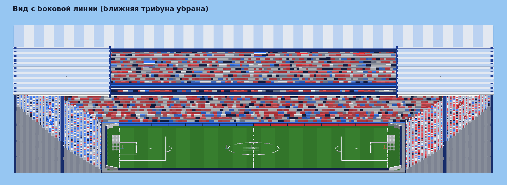

# Аниме-футбол для Roblox

Своя игра в жанре аниме-футбола: две команды — **HOME** и **AWAY**, мяч, вратари-боты, большой дневной
стадион. Позже сюда добавятся стили (персонажи со способностями); сейчас они отключены.

Всё сделано кодом: стадион строится скриптом при запуске, анимации заданы позами в Luau, эффекты собраны из
деталей и частиц. Внешних моделей, текстур и анимаций игра не использует.



> Картинки в этом файле — не скриншоты Roblox. Это упрощённая отрисовка тех же данных, которые создаёт код
> (детали стадиона, позы анимаций, дерево интерфейса): без материалов, света и теней. В Studio всё выглядит
> богаче — газон с текстурой, солнце, облака, светящиеся линии.

## Как запустить

1. Скачай файл [`build/Resonance.rbxlx`](build/Resonance.rbxlx) (имя файла рабочее, внутри игры названий нет).
2. Открой его в **Roblox Studio** (двойной клик или *File → Open from File*).
3. Нажми **Play (F5)**. Начнётся отсчёт и розыгрыш с центра.
4. Проверить игру вдвоём на одном компьютере: вкладка *Test → Clients and Servers → Start* (2 игрока).
5. Выложить в Roblox: *File → Publish to Roblox*.

Одному играть можно: в воротах обеих команд стоят боты-вратари (выключаются в `Config.Bots.Goalkeepers`).

### Аватары R6

Игра сделана под **R6**. В файле места уже выставлен тип аватара R6. Если Roblox всё равно выдаст игроку R15
(например, в опубликованной игре с настройкой по умолчанию), сервер сам пересоберёт персонажа в R6 — с вещами и
цветами игрока. Чтобы этой подмены не было видно, после публикации поставь *Game Settings → Avatar → Avatar Type → R6*.

Вернуть R15 можно одной строкой: `Config.Avatar.RigType = "R15"` — анимации есть для обоих типов.

### Если хочешь добавить игру в своё уже существующее место

Открой `Resonance.rbxlx`, скопируй три папки и вставь в те же сервисы у себя:
`ReplicatedStorage/Shared`, `ServerScriptService/Server`, `StarterPlayer/StarterPlayerScripts/Client`.
Стадион строится в начале координат — убери оттуда Baseplate и SpawnLocation.
В *Lighting* поставь *Technology = Future* — так свет выглядит лучше всего.

## Управление

| Клавиша | Действие |
|---|---|
| WASD, Пробел | движение, прыжок |
| Shift | бег (тратит силы) |
| ЛКМ (держать и отпустить) | удар: чем дольше держишь, тем сильнее. Смотришь камерой выше — мяч летит выше |
| E | **без мяча — подкат**: выбивает мяч и оглушает соперника. **С мячом — дриблинг**: резкий уход в сторону движения, в этот момент подкат по тебе не проходит |
| F | пас. Сам находит партнёра в направлении взгляда |
| R | навес |
| Q | рывок — короткое ускорение, с мячом и без |
| H | показать/скрыть подсказку |
| Ctrl | закрепить камеру (Shift Lock перенесён сюда, потому что Shift — это бег) |

Когда вернутся стили, добавятся Z и X (способности), C (ульта) и M (меню стилей).

Геймпад и сенсорные кнопки для телефона привязаны, но вживую не проверялись.
Клавиши меняются в `src/shared/Config.luau`, раздел `Controls`.


## Правила игры

- Мяч подбирается сам, когда подбегаешь к нему. С мячом ты чуть медленнее, а вокруг тебя на газоне видны круги.
- Слабый мяч можно принять. Слишком быстрый — только **отбить**: он отлетает от игрока. Партнёр принимает более сильные передачи, чем соперник.
- Вратарь ловит обычные удары, а сильный заряженный удар только отбивает.
- Аутов нет: поле окружено бортами, мяч от них отскакивает. За воротами тоже можно играть.
- Матч идёт 5 минут. После гола — розыгрыш с центра у пропустившей команды. После финального свистка сразу начинается новый матч.

## Поле и стадион

- Поле 380 × 240 студов (было 260 × 150), ворота 40 × 14. Все размеры — в `src/shared/FieldSpec.luau`,
  стадион и разметка перестраиваются под них сами.
- Тёмный насыщенный газон с еле заметными полосами покоса.
- Высокая закрытая чаша: два крутых яруса, плотная толпа (синие — за HOME, красные — за AWAY), растяжки
  болельщиков, туннель для выхода игроков, синие светящиеся линии по ярусам.
- Крыша-кольцо из белых и голубых панелей, над полем — открытое небо с облаками.
- Светодиодные борта: синие на половине HOME, красные на половине AWAY. Табло под крышей: HOME — счёт — AWAY и время.
- Дневной свет с голубоватым оттенком, технология освещения Future.


## Стили (сейчас отключены)

Четыре стиля-примера (Комета, Мираж, Гравитон, Бастион) убраны в [`archive/styles/`](archive/styles/).
Пока в игре нет ни одного стиля, все играют базовым стилем без способностей, а меню стилей, клавиши Z/X/C и
шкала Резонанса скрыты. Как только в `src/shared/Styles/` появится хотя бы один стиль, всё это включится само.

### Как добавить свой стиль (своего OC)

1. Скопируй `src/shared/Styles/_Template.luau` и назови файл именем стиля без подчёркивания, например `Phoenix.luau`.
2. Поменяй `id`, `name`, `role`, цвета, характеристики (`stats`) и способности.
3. Пересобери место (см. ниже) — стиль сам появится в меню.

В шаблоне расписано, что доступно способности: удар по мячу с любыми параметрами, рывки и телепорт,
притяжение мяча, бафы скорости, неуязвимость, «окно отбора», а на клиенте — сферы, диски, лучи, шлейфы,
послеобразы, тряска камеры, анимации. Стили из `archive/styles/` — хорошие примеры.

## Анимации

Все анимации заданы кодом и проигрываются поверх стандартного бега Roblox: замах, удар, усиленный удар,
пас, навес, подкат, дриблинг, рывок, таран, оглушение, «каст», стойка ульты, празднование гола, прыжки вратаря.
Позы пишутся один раз (для R15), а в R6 пересчитываются автоматически.

На R6 (основной вариант):


Те же анимации на R15 — в [`docs/animations-r15.png`](docs/animations-r15.png).

### Свои анимации из Blender (или Moon Animator)

Да, так можно, и выглядеть они будут лучше кодовых. Путь такой:

1. Сделать анимацию на R6-риге в Blender (с плагином для экспорта в Roblox) или прямо в Studio —
   во встроенном Animation Editor или в Moon Animator.
2. Загрузить её в Studio и опубликовать (*Publish to Roblox*). Публиковать нужно с того же аккаунта или группы,
   которым принадлежит игра, — иначе Roblox анимацию не проиграет.
3. Скопировать ID анимации и вписать его в `src/shared/Config.luau`, раздел `AnimationIds`, под нужным именем:

   ```lua
   Config.AnimationIds = {
   	Shoot = "rbxassetid://1234567890",
   	Slide = "rbxassetid://1234567891",
   }
   ```

Игра сама начнёт проигрывать твою анимацию вместо встроенной; всё, для чего ID не указан, остаётся на кодовых
позах. Имена всех анимаций перечислены в комментарии к `AnimationIds`.

## Что где лежит

```
src/shared/       общий код: Config (весь баланс), FieldSpec (размеры поля), Animations, Styles
src/server/       FieldBuilder (стадион), BallService (мяч), MatchService (матч), ActionService (действия игроков),
                  Actors (состояние игроков), BotService (вратари), PlayerService, Physics, Net
src/client/       Controls (управление), Hud (интерфейс), Fx и FxEvents (эффекты), ProcAnimator (анимации),
                  BallVisuals (шлейф, вращение мяча, круги под игроком), Sfx (звук)
archive/styles/   отключённые стили-примеры
build/            Resonance.rbxlx — готовое место для Studio
tools/            проверка без Studio: эмулятор, тесты, отрисовка картинок
docs/             картинки для этого файла
```


## Что проверено, а что нет

Roblox Studio из среды, где писался код, запустить нельзя. Поэтому я сделал эмулятор (`tools/harness`):
он загружает собранный `.rbxlx`, выполняет настоящий серверный и клиентский код и проигрывает матч.
Имена и типы свойств Roblox при этом проверяются по настоящей базе API.

**Проверено эмулятором (81 проверка, 0 ошибок выполнения):** постройка стадиона и отсутствие старых названий,
вход игрока и команды HOME/AWAY, персонажи R6 и пересборка R15 в R6, интерфейс без стилей, розыгрыш, подбор и
ведение мяча, круги под игроком с мячом, спринт и силы, удар с зарядом, пас, навес, рывок, клавиша E (подкат без
мяча, дриблинг с мячом и уход от подката), блок быстрого удара, гол и счёт, вратари (ловят, прыгают, выбивают),
смерть и респаун, выход игрока, финальный свисток и новый матч.

Отдельно проверяется сборка со стилями из архива (132 проверки — чтобы их код не сломался, пока они отключены)
и стресс-тест (`tools/harness/monkey.luau`): три игрока жмут случайные кнопки, шлют серверу мусор, перерождаются
и выходят из игры прямо с мячом — без ошибок.

**Не проверено — это покажет только запуск в Studio:**

- как выглядит стадион вживую: свет, тени от крыши, облака, неон, газон;
- производительность: на стадионе около 7 500 деталей (в основном толпа). На слабых телефонах может быть тяжело —
  тогда толпу можно сделать реже (`CROWD_SEGMENT_MIN/MAX` в `FieldBuilder.luau`);
- настоящая физика Roblox: отскоки мяча, передача сетевого владения мячом, ощущение рывков;
- что Studio применит тип аватара R6 из файла места, и как выглядит пересборка R15 в R6 на живом аватаре;
- задержка сети между игроками;
- сенсорные кнопки и геймпад;
- звуки: сейчас это встроенные звуки Roblox как заглушки (заменяются в `Config.Sounds`).

Если в Studio что-то сломается или выглядит не так — пришли текст ошибки из окна *Output* или скриншот.

## Для разработки

Нужны [Rojo](https://rojo.space), [Lune](https://lune-org.github.io/docs), Selene и StyLua.

```sh
rojo build default.project.json -o build/Resonance.rbxlx   # собрать место
./tools/check.sh                                            # формат, линтер, сборка, все тесты
./tools/check.sh --previews                                 # то же + перерисовать картинки в docs/
rojo serve                                                  # живая синхронизация кода со Studio (плагин Rojo)
```
